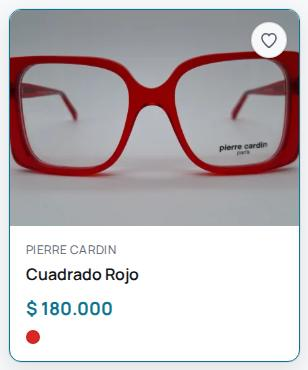
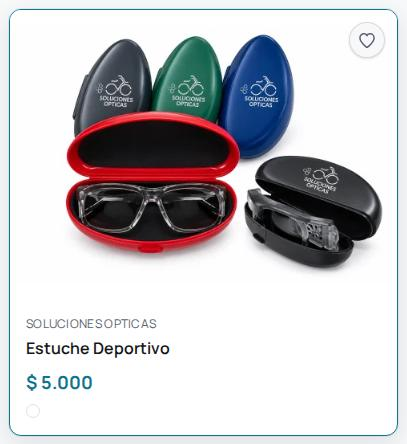
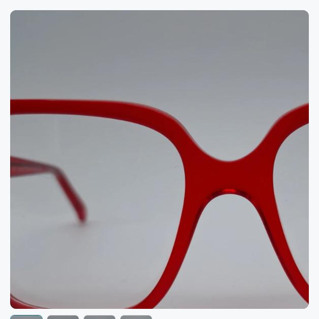
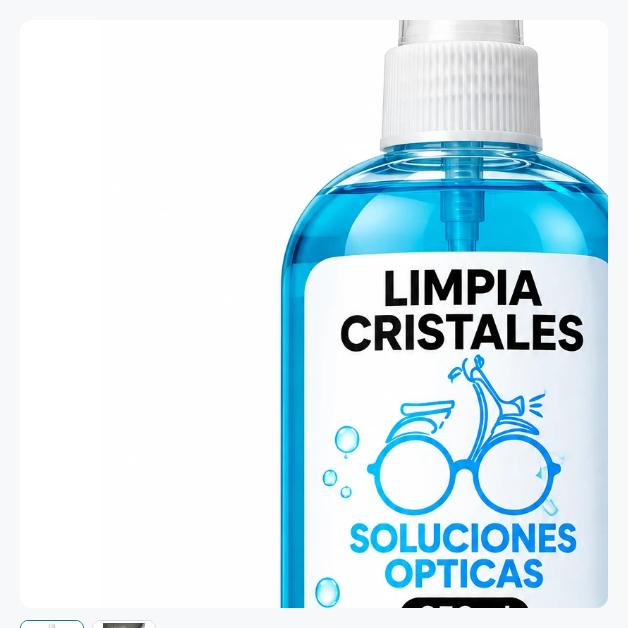
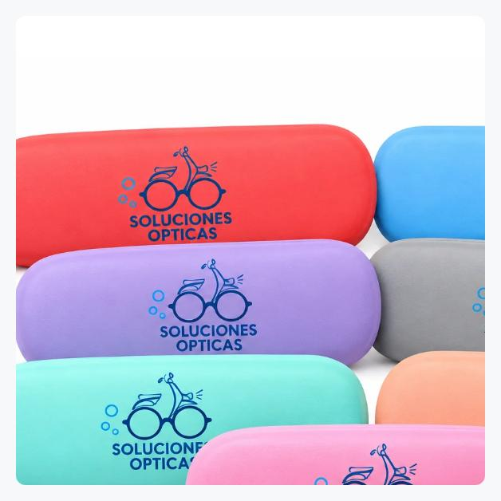
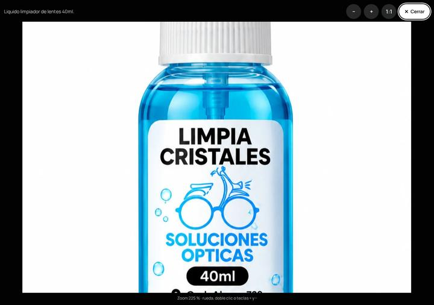
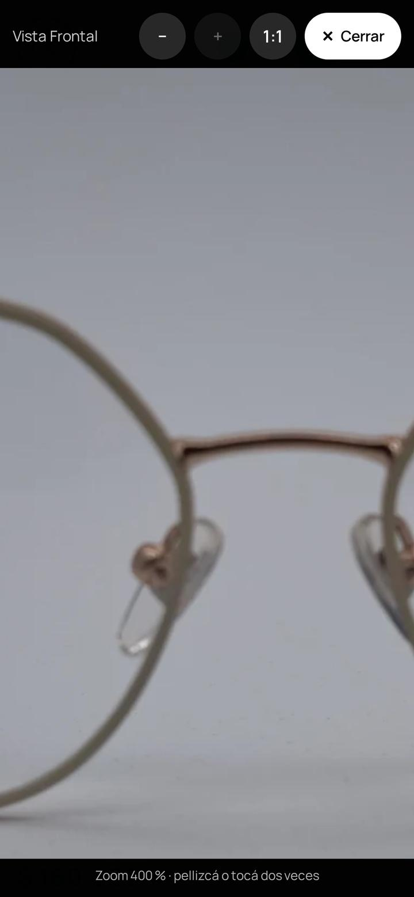
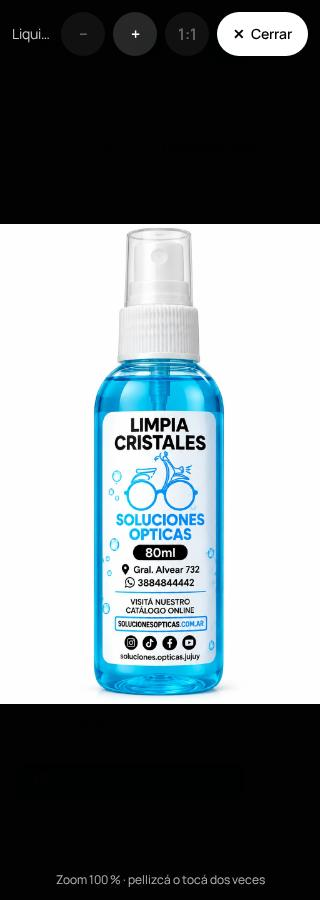
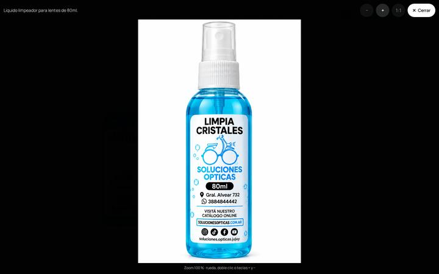

# Zoom de fotos de producto

- **Fecha:** 2026-10-18
- **Pedido de:** Roberto.
- **Rama:** `feature/product-image-zoom`, creada desde el candidato verificado `9564915`. Ese candidato incluye la corrección de fotos de accesorios (`e051a7e`), la auditoría web y la selección múltiple de colores. No incluye ruleta, Payments V1 ni Virtual Try-On.
- **Estado:** solo local. No hubo push, merge ni deploy.

## Qué hace

| Dónde                                | Comportamiento                                                                                                                                                                                                                                                                                                                                                |
| ------------------------------------ | ------------------------------------------------------------------------------------------------------------------------------------------------------------------------------------------------------------------------------------------------------------------------------------------------------------------------------------------------------------- |
| **Tarjetas** (anteojos y accesorios) | Al pasar el mouse, la foto crece un 8 % **dentro de su marco**, con una transición de 0,5 s. Texto, precio, colores y favorito no se mueven. Los anteojos siguen en _cover_; los accesorios, en _contain_ sobre blanco: con el 8 % la botella o el estuche solo ocupan su margen blanco y se siguen viendo enteros. Con `prefers-reduced-motion` no hay zoom. |
| **Ficha, con mouse**                 | Una **lente 2×** que sigue al cursor con precisión: el punto bajo el puntero queda fijo. Usa la versión más grande que tiene la foto en Cloudinary. Al sacar el mouse, vuelve la vista normal.                                                                                                                                                                |
| **Ficha, con clic, toque o teclado** | Se abre una **vista ampliada** a pantalla completa (modal nativo): • **táctil:** pellizco, arrastre y doble toque; • **mouse:** rueda, arrastre y doble clic; • **botones:** − / + / 1:1, de 1× a 4×; • **teclado:** `+` `−` `0` y flechas; • **Escape** o el botón **Cerrar** (visible, 44 px). El foco vuelve a la foto al cerrar.        |
| **Galería y colores**                | El zoom siempre usa la foto seleccionada, la de la miniatura o el color elegido. Al cambiar de foto, el zoom arranca de cero.                                                                                                                                                                                                                                 |

**Accesibilidad:**

- La foto conserva su `alt`. Encima tiene un botón "Ampliar foto: …" (`aria-haspopup="dialog"`), alcanzable con Tab.
- La vista ampliada es un `<dialog>` con nombre, la página detrás queda inerte y Tab queda dentro.
- El nivel de zoom se anuncia con `role="status"`.
- El zoom es opcional: el producto, el precio, los colores y WhatsApp se usan igual sin tocarlo.

## Resolución y Cloudinary

| Foto original en Cloudinary (medida) | Ancho   | Tamaño lógico de la ficha                         |
| ------------------------------------ | ------- | ------------------------------------------------- |
| Anteojos                             | 1500 px | 2× sobre ~600 px → detalle real                   |
| Estuches                             | 1536 px | ídem                                              |
| Limpiadores                          | 1024 px | 2× → ~0,85 px reales por px: el máximo que existe |

- **Cómo se pide la foto grande:** `f_auto,q_auto,c_limit,w_2000`. `c_limit` achica pero **nunca agranda**, así que se recibe la foto real (1500, 1536 o 1024 px) y no una versión agrandada artificialmente. f_auto y q_auto siguen como en todo el sitio.
- **Qué pasa en Cloudinary:** no se suben, borran ni modifican archivos. Sí se crea una **variante de entrega** por foto (como cualquier URL `w_…` nueva) la primera vez que alguien hace zoom. Eso consume cuota de transformaciones del plan (una por foto, que luego queda en caché).
- **Limpiadores:** sus fotos de 1024 px son la limitación real. Para más nitidez habría que **subir fotos de mayor resolución** desde el admin. No se tocó nada en Cloudinary.

## Rendimiento (medido en Chromium, con el catálogo real servido desde un snapshot)

| Página                          | Imágenes         | Peso                   | Alta resolución en la carga |
| ------------------------------- | ---------------- | ---------------------- | --------------------------- |
| `/accesorios` (desktop y móvil) | 6, todas `w_480` | 185 KB                 | **No**                      |
| Ficha `cuadrado-rojo`, desktop  | 5                | 59 KB                  | **No**                      |
| Ficha `cuadrado-rojo`, móvil    | 5                | 49 KB                  | **No**                      |
| + lente al pasar el mouse       | +1               | +65 KB, solo si se usa | —                           |

- **Tarjetas:** usan exactamente el mismo `srcset` y `sizes` que antes; nunca piden más de `w_640`.
- **CLS:** 0,000 al hacer hover en tarjetas, al usar la lente y al abrir la vista ampliada (todo es `transform` u `opacity`, sin cambios de layout).
- **Vista ampliada en celular:** muestra al instante (≤ 50 ms) la foto que la página ya tenía cargada, y la cambia por la grande cuando llega.
- **JS:** el bundle principal pasa de 396,15 a 396,33 kB (+0,18 kB). La lente y la vista ampliada viven en el chunk diferido de la ficha. Sin librerías nuevas.

## Pruebas

| Prueba                                                                                                                                          | Resultado                                                                                                         |
| ----------------------------------------------------------------------------------------------------------------------------------------------- | ----------------------------------------------------------------------------------------------------------------- |
| `format`, `lint`, `typecheck:api` y `typecheck:web`, `build:api` y `build:web`, `db:validate`                                                   | OK                                                                                                                |
| `test:api`                                                                                                                                      | 400/400                                                                                                           |
| `test:web`                                                                                                                                      | **355/355** (nuevos: `product-zoom.test.tsx`, 5; los tests de tarjetas se actualizaron a la nueva especificación) |
| **Chromium, zoom** (`zoom_e2e.py`, fotos reales)                                                                                                | **14/14** (detalle abajo)                                                                                         |
| Encuadre de accesorios (`acc_fit_e2e`)                                                                                                          | 11/11                                                                                                             |
| Regresión: accesorios 12, colores 12, fase 2 15, correcciones 11, revisión 10, orden de fotos 10, principal 11, subida de imágenes 19, login 17 | **117/117**                                                                                                       |
| axe + responsive del sitio completo (15 páginas, claro y oscuro, 6 anchos)                                                                      | 0 violaciones, 0 overflow, 0 errores de consola                                                                   |

**Detalle de Chromium (zoom):**

1. Tarjetas de anteojos: escala 1,08, texto fijo, favorito encima, sin imágenes de más de `w_640`, CLS 0.
2. Tarjetas de accesorios: igual que las de anteojos, con _contain_ y fondo blanco.
3. Con reducción de movimiento: sin zoom.
4. Limpiadores de 40, 80 y 250 ml y los tres estuches (recetados, sol y deportivos): producto completo dentro del marco en reposo.
5. Lente en `cuadrado-rojo`, `limpiador-250ml` y `estuche-recetados`: sigue al cursor (±1 %), escala 2×, foto real de 1500, 1024 y 1536 px, se pide recién con el hover, vuelve al salir.
6. Galería de 4 fotos: la lente usa la elegida.
7. Color "Negro" de `cuadrado-mediano-bordo`: la lente usa sus fotos y WhatsApp nombra el color.
8. Teclado: Tab llega a la foto y Enter abre. El dialog es modal, el foco va a Cerrar y Tab no sale. `+` lleva a 225 % y la rueda funciona. Escape cierra y el foco vuelve.
9. Táctil (390 px):
   - deslizar sobre la foto desplaza la página (332 px) sin abrir nada;
   - un toque abre la vista ampliada;
   - el pellizco llega a 400 % y el arrastre mueve la foto;
   - Cerrar mide 44 px y cierra;
   - después, la página se desplaza normal.
10. Doble toque: 250 % y de vuelta a 100 %.
11. A 320, 375, 390, 768, 1280 y 1440 px: sin scroll horizontal en catálogo ni fichas; la vista ampliada ocupa la pantalla con todos sus botones visibles.
12. axe WCAG 2.2 AA: 0 violaciones en ficha, accesorio y catálogo, y con la vista ampliada abierta.

**Problemas encontrados y corregidos durante las pruebas:**

- La lente arrancaba centrada si el mouse quedaba quieto mientras cargaba. Ahora guarda la última posición.
- En Chrome, Tab podía salir del modal hacia la barra del navegador. Ahora el foco da la vuelta dentro de la vista.
- **Al levantar los dos dedos después de un pellizco, se leía como "doble toque" y el zoom volvía a 100 %.** Ahora solo cuenta como toque uno con un solo dedo, corto y sin movimiento.
- En celular, la vista ampliada quedaba negra hasta que llegaba la versión grande. Ahora muestra la foto que ya estaba cargada.
- **(2026-10-19, prueba manual con "Cuadrado Patilla Gruesa")**
  - **Problema:** tocar "Cerrar" menos de 200 ms después de arrastrar la foto ampliada no hacía nada. Chrome no genera el `click` de un toque que sigue a un arrastre sobre un área con `touch-action: none`; la captura de puntero no era la causa.
  - **Corrección:** "Cerrar" ahora cierra en `touchend` cuando el toque empieza y termina sobre él, con `preventDefault()` para que el `click` tardío no caiga en el header de abajo. Mouse, Enter y Space siguen con el `click`.
  - **Verificado:**
    - 10 de 10 cierres inmediatos con las dos fotos;
    - 0 clicks fantasma;
    - deslizar el dedo fuera de "Cerrar" no cierra;
    - Escape, Enter y la restauración del foco intactos;
    - pellizco, arrastre y desplazamiento sin cambios.

**Tests actualizados por cambio de especificación** (las versiones originales se conservan como `*.orig.py` en el scratchpad):

- Las tarjetas de anteojos tenían un zoom de 1.02 y los accesorios no tenían zoom. Roberto pidió zoom en ambos, así que se actualizaron los tests unitarios de tarjetas y una aserción de `acc_fit_e2e`.
- Se mantiene la condición de que en reposo el accesorio esté entero y sin escala.

**Entorno:**

- El puerto 5173 lo ocupa otro proyecto del usuario (`SD4/qatu`). No se tocó: las pruebas usaron el 5174, con la API local reiniciada para aceptar ese origen solo por variable de entorno.
- `synthesizeScrollGesture` no desplaza en Chromium headless, así que se usaron eventos táctiles reales por CDP.

## Capturas

| Tarjeta de anteojo (hover)             | Tarjeta de accesorio (hover)               |
| -------------------------------------- | ------------------------------------------ |
|  |  |

| Lente en la ficha: anteojo               | Lente: limpiador 250 ml                    | Lente: estuche recetados                     |
| ---------------------------------------- | ------------------------------------------ | -------------------------------------------- |
|  |  |  |

| Vista ampliada, desktop (225 %)               | Móvil 390 px, pellizco (400 %)                | 320 px                             | 1440 px                             |
| --------------------------------------------- | --------------------------------------------- | ---------------------------------- | ----------------------------------- |
|  |  |  |  |

## GO / NO-GO para publicar el zoom

**GO para revisión.** Todo está probado localmente con las fotos reales.

**NO-GO para producción** hasta que se cumpla lo siguiente:

1. Tu autorización.
2. Probarlo en un iPhone y un Android reales (gestos). La emulación por CDP es fiel pero no reemplaza un teléfono.
3. Publicarlo **después** de los pasos A y B del candidato (la auditoría y multicolor), porque esta rama está construida sobre ellos. Publicarlo sobre `e051a7e` arrastraría esos cambios sin su verificación propia.

**Nota aparte:** producción ahora tiene **19 armazones reales**. La decisión de la auditoría de dejar WhatsApp como CTA principal de la home ("0 armazones") conviene revisarla.
