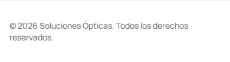
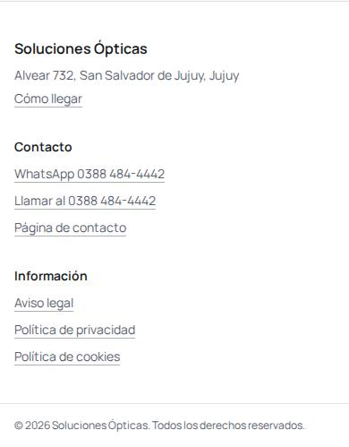
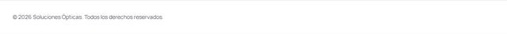
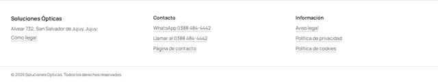
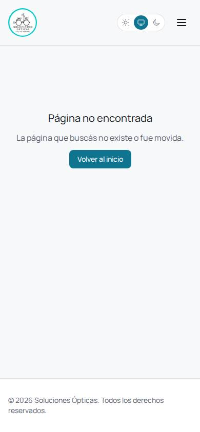
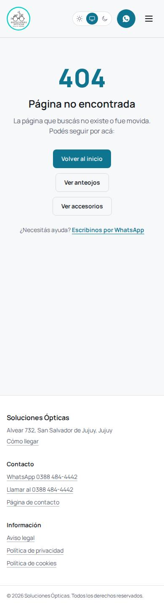
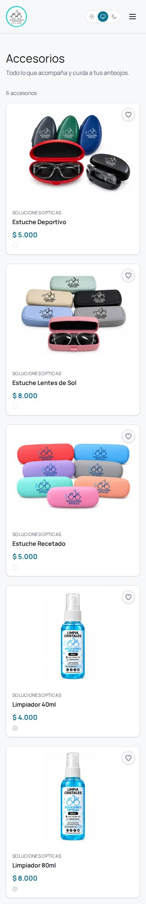
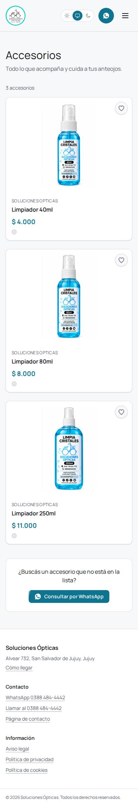
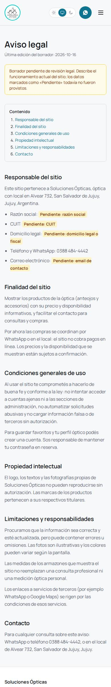
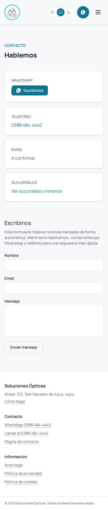

# Auditoría de 20 puntos del sitio web — Soluciones Ópticas Jujuy

- **Fecha:** 2026-10-16
- **Rama:** `chore/website-20-point-audit` (creada desde `e051a7e`, el commit publicado hoy en Vercel y Railway)
- **Estado:** todo es local. No hubo push, merge, deploy ni migración remota, y no se modificó la base real ni Cloudinary.
- **Datos de prueba:** las mediciones locales usan la base de desarrollo en Docker y datos QA ficticios, que se borran al terminar (cada script lo verifica). Las mediciones de producción fueron solo lectura: navegación y Lighthouse, sin formularios ni escrituras.

## 1. Resumen de los 20 puntos

| #   | Punto                       | Estado                                                                                             | Qué se hizo / qué falta                                                                                                                                                                                                                                                                                                         |
| --- | --------------------------- | -------------------------------------------------------------------------------------------------- | ------------------------------------------------------------------------------------------------------------------------------------------------------------------------------------------------------------------------------------------------------------------------------------------------------------------------------- |
| 1   | Aviso legal                 | **PENDIENTE DE APROBACIÓN LEGAL** (y de datos)                                                     | Borrador en `/aviso-legal`, enlazado desde el footer y con `noindex`. Los datos legales son marcadores `[[PENDIENTE: …]]` visibles (razón social, CUIT, domicilio legal, email); no se inventó ninguno. Hay un aviso de "borrador" en la página.                                                                                |
| 2   | Privacidad                  | **PENDIENTE DE APROBACIÓN LEGAL** (y de datos)                                                     | Borrador en `/privacidad` (Ley 25.326): describe los datos que el código realmente trata (cuenta, pedidos, consultas por WhatsApp) y marca como pendientes el responsable, los plazos de conservación y la ubicación de los proveedores.                                                                                        |
| 3   | Cookies                     | **PENDIENTE DE APROBACIÓN LEGAL**                                                                  | `/cookies` lista lo que el sitio guarda hoy, verificado contra el código: `sopt_access_token` (15 min), `sopt_refresh_token` (30 días) y `sopt-theme` (localStorage). Con la analítica apagada no hay cookies opcionales, así que no se muestra banner. Si se configura GA4, aparecen el banner y la preferencia en `/cookies`. |
| 4   | HTTPS                       | **VERIFICADO** (en producción) · headers: **PENDIENTE DE VERIFICACIÓN EN PRODUCCIÓN**              | Medido en producción: HTTP→HTTPS 308, apex→www 308, HSTS presente. Se agregaron `X-Content-Type-Options`, `Referrer-Policy`, `X-Frame-Options` y `Permissions-Policy` en `vercel.json`.                                                                                                                                         |
| 5   | Meta tags y SEO             | **IMPLEMENTADO Y PROBADO LOCALMENTE** · producción pendiente                                       | Cada ruta pública tiene su `<head>` (title, description, canonical, OG/Twitter) generado en el build (`dist/<ruta>.html`), sin cambiar de framework. Login, cuenta, admin, páginas legales y 404 llevan `noindex`. El alias `*.vercel.app` recibe `X-Robots-Tag: noindex`.                                                      |
| 6   | JSON-LD                     | **IMPLEMENTADO Y PROBADO LOCALMENTE** · validación con Google pendiente                            | `Optician` estático (Alvear 732, teléfono, logo; **sin horarios**, porque no están cargados), `WebSite` en la home, y `Product` + `Offer` + `BreadcrumbList` en el detalle. Falta pasarlo por el Rich Results Test después de publicar.                                                                                         |
| 7   | Sitemap y robots            | **IMPLEMENTADO Y PROBADO LOCALMENTE** · producción pendiente                                       | `/sitemap.xml` dinámico desde la API: rutas estáticas más productos públicos. Vercel lo reescribe al API. `robots.txt` deja fuera `/admin` y `/account` y declara el sitemap. **Hoy en producción `/sitemap.xml` devuelve el HTML de la SPA.**                                                                                  |
| 8   | Google Business Profile     | **PENDIENTE DE DATOS** (acción manual)                                                             | No se puede hacer desde el código. En la base, horarios, coordenadas y `googleMapsUrl` están vacíos y no se inventaron. El footer enlaza a "Cómo llegar" con una búsqueda de Maps por la dirección.                                                                                                                             |
| 9   | Favicon                     | **IMPLEMENTADO Y PROBADO LOCALMENTE**                                                              | `favicon.ico`, 32×32, `apple-touch-icon` y los íconos 192/512 más `manifest.webmanifest`, generados **del logo oficial** (`apps/api/assets/soluciones-opticas-logo.jpg`). Se reemplaza el `favicon.svg` genérico. Pesan entre 2 y 35 KB.                                                                                        |
| 10  | Textos alternativos         | **IMPLEMENTADO Y PROBADO LOCALMENTE**                                                              | Las miniaturas de la galería pasan a `alt=""` (antes repetían el alt de la imagen principal: `image-redundant-alt` en Lighthouse). Las fotos de producto conservan el alt cargado desde el admin. axe: 0 violaciones.                                                                                                           |
| 11  | Compresión de imágenes      | **VERIFICADO**                                                                                     | Las fotos ya salen de Cloudinary con `f_auto,q_auto` y un ancho por tamaño (`w_…`). No hubo que recomprimir nada. Se agregó carga prioritaria (`fetchpriority="high"`, sin lazy) para las 3 primeras tarjetas, que forman el LCP.                                                                                               |
| 12  | Velocidad                   | **IMPLEMENTADO Y PROBADO LOCALMENTE** · producción pendiente                                       | CLS de `/accesorios` en móvil: de 0.128 a **0**. Un visitante anónimo pasa de 4 llamadas 401 (`/me` + `/refresh` ×2) a **una sola 200** (`/api/auth/session`). Best Practices sube de 96 a 100. Detalle en §4.                                                                                                                  |
| 13  | Contraste (WCAG 2.2 AA)     | **IMPLEMENTADO Y PROBADO LOCALMENTE**                                                              | axe-core 4.10.3 (wcag2a/aa, 21a/aa, 22aa): **0 violaciones** en 15 páginas, en tema claro y oscuro, a 390 y 1280 px, más admin. Se corrigieron los badges del admin (nuevo token `success-strong`), el orden de encabezados y los links del footer (siempre subrayados).                                                        |
| 14  | Diseño móvil                | **IMPLEMENTADO Y PROBADO LOCALMENTE**                                                              | Barrido a 320/375/390/768/1280/1440: sin overflow horizontal ni controles recortados. El toggle de contraseña ahora tiene un objetivo táctil de 36 px y el encabezado del detalle de producto hace wrap.                                                                                                                        |
| 15  | Página 404                  | **IMPLEMENTADO Y PROBADO LOCALMENTE** · HTTP 404 real: **PENDIENTE DE VERIFICACIÓN EN PRODUCCIÓN** | Nueva 404 con la marca, `noindex`, un CTA principal ("Volver al inicio"), dos secundarios y un link a WhatsApp. Vercel deja de usar el catch-all: las rutas desconocidas sirven `404.html` con estado 404. **Hoy producción responde 200 (soft 404).**                                                                          |
| 16  | Enlaces rotos               | **VERIFICADO**                                                                                     | Rastreo de producción: 16 páginas, 0 enlaces internos que terminen en 404, y los 10 externos (wa.me, Google Maps) responden 200. Rastreo local después: 26 páginas, 0 rotos, 17 externos con 200. Las rutas nuevas tienen tests: la paridad entre rutas, sitemap y `vercel.json` está cubierta.                                 |
| 17  | Protección contra spam      | **VERIFICADO**                                                                                     | El formulario de contacto **no envía nada a ningún servidor** (lo aclara en pantalla), así que no hay vector de spam. Se le agregaron `maxLength` (100/254/2000). Login, registro y refresh ya tenían rate limit en la API. Si el formulario pasa a enviar datos: rate limit más honeypot antes de publicarlo.                  |
| 18  | Botón de WhatsApp visible   | **IMPLEMENTADO Y PROBADO LOCALMENTE**                                                              | En pantallas menores a `xl`, el header muestra siempre un botón compacto de WhatsApp (44×44, con nombre accesible). También está en el footer, en contacto y en el detalle de producto.                                                                                                                                         |
| 19  | Analítica                   | **PENDIENTE DE DATOS** (preparada y **apagada**)                                                   | GA4 solo se carga si hay `VITE_GA4_MEASUREMENT_ID` (formato `G-…`) **y** el visitante aceptó. Sin ID no hay banner, ni script, ni eventos. Eventos sin datos personales: `view_item`, `select_variant`, `whatsapp_click`, `catalog_click`. Falta el ID real y la revisión de privacidad.                                        |
| 20  | Un CTA principal por página | **IMPLEMENTADO Y PROBADO LOCALMENTE**                                                              | Ver §5. Las acciones secundarias se mantienen como secundarias; no se eliminaron.                                                                                                                                                                                                                                               |

## 2. Commits (rama `chore/website-20-point-audit`)

| Commit    | Puntos         | Descripción                                                                                          |
| --------- | -------------- | ---------------------------------------------------------------------------------------------------- |
| `b6eb9db` | 1, 2, 3, 18    | Borradores legales y footer con dirección, contacto y links legales                                  |
| `3d8ed4d` | 5, 6, 7, 9     | Heads por ruta en el build, JSON-LD, sitemap dinámico, robots, favicons, headers y routing de Vercel |
| `811f3a5` | —              | Formato de `index.html` (Prettier)                                                                   |
| `427ad24` | 10, 11, 12     | Sin layout shift en el catálogo, imagen LCP primero, alt de miniaturas                               |
| `abdbb87` | 13, 14, 15, 18 | Correcciones WCAG 2.2 AA, 404 con marca, WhatsApp siempre visible en móvil                           |
| `f838d6f` | 12, 17         | `GET /api/auth/session`: sin 401 para visitantes anónimos; límites del formulario de contacto        |
| `b748bed` | 3, 19          | Analítica con consentimiento, preparada y apagada                                                    |
| `211cb28` | 5              | El plugin de prerender resuelve un `outDir` absoluto                                                 |
| `1cfca06` | 12             | El footer queda debajo del pliegue mientras cargan las páginas (CLS 0.192 → 0)                       |
| `1d79dd5` | 20             | 404 con un único botón principal (WhatsApp pasa a link)                                              |

Son 80+ archivos. Los principales:

- **Web, contenido legal:** `apps/web/src/content/legal-content.ts`, `pages/LegalPage.tsx`, `components/layout/Footer.tsx`.
- **Web, SEO:** `components/ui/SeoHead.tsx`, `lib/seo.ts`, `lib/seo-routes.ts`, `lib/seo-head-html.ts`, `scripts/prerender-heads.ts`.
- **Web, analítica y consentimiento:** `lib/analytics.ts`, `components/layout/AnalyticsConsent.tsx`.
- **Web, configuración y estáticos:** `vercel.json`, `index.html`, `public/*`.
- **API:** `services/sitemap.service.ts`, `routes/sitemap.routes.ts`, `controllers/auth.controller.ts` (`session`), `routes/auth.routes.ts`, `services/users.service.ts`.
- **Shared:** `packages/shared/src/auth.ts` (`SessionDto`).

## 3. Pruebas y gates

| Gate                                         | Resultado                                                                                                                |
| -------------------------------------------- | ------------------------------------------------------------------------------------------------------------------------ |
| `npm run format` (Prettier check)            | OK                                                                                                                       |
| `npm run lint`                               | OK                                                                                                                       |
| `typecheck:api` / `typecheck:web`            | OK                                                                                                                       |
| `build:api` / `build:web`                    | OK (el build escribe 10 heads por ruta más `404.html`)                                                                   |
| `db:validate`                                | OK                                                                                                                       |
| `test:api`                                   | **388/388**. Nuevos: `sitemap.test.ts` (3), `auth-session.test.ts` (6)                                                   |
| `test:web`                                   | **331/331**. Nuevos: `legal-pages` (7), `seo` (13), `perf-images`, `not-found-page`, `auth-session` (5), `analytics` (6) |
| axe-core + barrido responsive (Chromium)     | 0 violaciones, 0 overflow, 0 errores de consola                                                                          |
| Lighthouse antes/después (local)             | §4                                                                                                                       |
| Rastreo de enlaces                           | Producción: 0 rotos (§1, punto 16)                                                                                       |
| Regresión Chromium (suites de fases previas) | §3.1                                                                                                                     |

Los tests nuevos verifican comportamiento real y no se ajustaron para forzar resultados. Dos tests existentes cambiaron porque cambió lo que verifican:

- **Test del header:** ahora espera dos links "Escribinos" (el rotulado y el compacto), los dos apuntando al número real.
- **Test de la 404:** busca el link de WhatsApp por su texto nuevo.

### 3.1 Regresión Chromium

Se corrieron las suites Chromium de fases anteriores contra esta rama: web en dev con `VITE_CLOUDINARY_CLOUD_NAME=qa-local`, API local y base de desarrollo, con datos QA que cada suite crea y borra. Cloudinary siempre está simulado.

| Suite             | Esta rama | Base `e051a7e` (misma API y base) | Conclusión                                                                                                                                                                                                                                                                                                                                          |
| ----------------- | --------- | --------------------------------- | --------------------------------------------------------------------------------------------------------------------------------------------------------------------------------------------------------------------------------------------------------------------------------------------------------------------------------------------------- |
| `img_e2e_traced`  | 19/19     | —                                 | OK                                                                                                                                                                                                                                                                                                                                                  |
| `primary_e2e`     | 11/11     | —                                 | OK                                                                                                                                                                                                                                                                                                                                                  |
| `phase2_e2e`      | 15/15     | —                                 | OK                                                                                                                                                                                                                                                                                                                                                  |
| `fixes_e2e`       | 11/11     | —                                 | OK                                                                                                                                                                                                                                                                                                                                                  |
| `auth_e2e`        | 17 PASS   | —                                 | OK. Los 401/409 que registra como INFO son los intentos inválidos que la suite provoca a propósito                                                                                                                                                                                                                                                  |
| `review2_e2e`     | 9/10      | —                                 | **Cambio esperado, no regresión.** El caso que falla exige "exactamente un `/me` + un `/refresh`" para un visitante; esta rama lo reemplaza a propósito por un único `200 /api/auth/session`. El nuevo comportamiento está cubierto por `auth-session.test.ts` (API), `auth-session.test.tsx` (web) y la medición de §4.2. La suite no se modificó. |
| `order_e2e`       | 8/10      | **8/10, mismos 2 casos**          | Falla previa a esta rama (deriva de la suite): foco tras Shift+Tab y el texto al eliminar la principal                                                                                                                                                                                                                                              |
| `accessories_e2e` | 4/12      | **4/12, mismos 8 casos**          | Falla previa a esta rama: la suite se actualizó para la rama de multicolor (`8849f3f`, encabezado "Colores y presentaciones"), que no está en `e051a7e` ni acá                                                                                                                                                                                      |

Las fallas de `order_e2e` y `accessories_e2e` se reprodujeron idénticas con el web de `e051a7e` (worktree temporal, ya eliminado). Por eso no son atribuibles a esta auditoría. No se ocultan, y quedan como deuda de las suites.

Las suites de ruleta (`prize_e2e`, `pw2_e2e`) y multicolor (`colors_e2e`) no aplican: esas funciones no están en esta rama.

**Rastreo de enlaces local, después:** 26 páginas (incluidas las legales y las fichas), 0 enlaces internos que terminen en 404 y 17 externos, todos con 200.

## 4. Métricas

### 4.1 Producción hoy (`e051a7e`, Lighthouse 12.8.2, solo lectura)

| Página                       | Disp.   | Perf | A11y | BP  | SEO | LCP   | CLS   |
| ---------------------------- | ------- | ---- | ---- | --- | --- | ----- | ----- |
| `/`                          | móvil   | 97   | 100  | 96  | 100 | 1.9 s | 0     |
| `/`                          | desktop | 100  | 100  | 96  | 100 | 0.4 s | 0     |
| `/accesorios`                | móvil   | 83   | 98   | 96  | 100 | 3.9 s | 0.128 |
| `/accesorios`                | desktop | 97   | 98   | 96  | 100 | 1.2 s | 0.033 |
| `/accesorios/limpiador-40ml` | móvil   | 91   | 100  | 96  | 100 | 3.4 s | 0.025 |
| `/accesorios/limpiador-40ml` | desktop | 97   | 100  | 96  | 100 | 1.3 s | 0.007 |

En todas las páginas, Best Practices pierde puntos por los errores 401 de `/api/auth/me` y `/api/auth/refresh` en consola.

### 4.2 Antes/después en condiciones idénticas (local)

Mismo API local, mismos 3 accesorios QA con fotos reales de Cloudinary (solo lectura) y `vite preview` de cada build. Los datos QA se borraron al terminar.

| Página                    | Disp.   | Perf antes → después | A11y     | BP           | LCP         | CLS           | Errores consola |
| ------------------------- | ------- | -------------------- | -------- | ------------ | ----------- | ------------- | --------------- |
| `/`                       | móvil   | 95 → 95              | 100      | 96 → 96\*    | 2.8 → 2.8 s | 0 → 0         | 7 → 3\*         |
| `/`                       | desktop | 100 → 100            | 100      | 96 → 96\*    | 0.6 → 0.7 s | 0 → 0         | 7 → 3\*         |
| `/accesorios`             | móvil   | 89 → **91**          | 98 → 100 | 96 → **100** | 2.9 → 3.4 s | **0.128 → 0** | 4 → **0**       |
| `/accesorios`             | desktop | 100 → 99             | 98 → 100 | 96 → **100** | 0.7 → 0.9 s | **0.035 → 0** | 4 → **0**       |
| `/accesorios/<limpiador>` | móvil   | 90 → **91**          | 100      | 96 → **100** | 3.5 → 3.3 s | **0.018 → 0** | 4 → **0**       |
| `/accesorios/<limpiador>` | desktop | 99 → 99              | 100      | 96 → **100** | 0.9 → 0.9 s | 0 → 0         | 4 → **0**       |

\* Los 3 errores que quedan en `/` son imágenes `dev-seed/*` que existen solo en la base local (armazones de seed). Pasa lo mismo antes y después; en producción no aplica.

**Llamadas de auth de un visitante anónimo en `/accesorios`:**

- Antes: `401 GET /me`, `401 POST /refresh`, `401 GET /me`, `401 POST /refresh`.
- Después: `200 GET /api/auth/session`.

**Lectura honesta de los números:**

- **CLS y los errores de consola** mejoran claramente.
- **LCP** queda dentro del ruido de una medición local con throttling (±0.3–0.5 s entre corridas). No se declara una mejora de LCP; hay que medirlo en producción.

## 5. Un CTA principal por página (punto 20)

Esto se midió en el navegador, no a ojo. `cta_count.py` cuenta los `a`/`button` visibles dentro de `<main>` cuyo fondo calculado es el color `primary`, en 15 páginas a 390 y 1280 px. Los resultados son iguales en los dos anchos.

| Página                                | Botones llenos medidos                                                          | Secundarios (se mantienen)                                                  |
| ------------------------------------- | ------------------------------------------------------------------------------- | --------------------------------------------------------------------------- |
| Home                                  | "Escribinos por WhatsApp" ×3 (la misma acción: hero, sección del local, cierre) | "Ver anteojos" (outline), "Cómo llegar" (outline), links de catálogo        |
| `/products` (0 armazones en prod)     | ninguno: las tarjetas son la acción                                             | Filtros, categorías, paginación                                             |
| `/accesorios`                         | "Consultar por WhatsApp"                                                        | Tarjetas, paginación                                                        |
| Detalle de accesorio / armazón        | "Consultar por WhatsApp" (con producto y color)                                 | Variantes, migas de pan, relacionados                                       |
| Contacto                              | "Escribinos" (WhatsApp)                                                         | Teléfono, email, botón del formulario (ahora secundario)                    |
| Login / Registro                      | "Ingresar" / "Crear cuenta"                                                     | Links cruzados                                                              |
| 404                                   | "Volver al inicio"                                                              | "Ver anteojos", "Ver accesorios" (outline) y link "Escribinos por WhatsApp" |
| Marcas, Nosotros, Sucursales, legales | ninguno (informativas)                                                          | Links                                                                       |

- **Header:** el botón de WhatsApp vive fuera de `<main>`; es navegación global, no el CTA de cada página.
- **Home:** hay **una sola acción principal**, repetida al inicio, al medio y al final de una página larga, y ninguna acción distinta compite con ella. Se dejó así a propósito: bajarla a secundaria en la sección del local cambiaría la identidad visual del bloque. **Queda para decidir en la revisión.**

En la home, el CTA principal sigue siendo WhatsApp a propósito: producción tiene **0 armazones** cargados y la home oculta las secciones vacías, así que "Ver anteojos" como principal llevaría a un catálogo vacío. Cuando haya armazones reales, conviene revisarlo.

## 6. Capturas (antes = producción hoy, después = local)

Las capturas están en [`website-20-point-audit/`](website-20-point-audit/).

| Qué              | Antes                                                     | Después                                               |
| ---------------- | --------------------------------------------------------- | ----------------------------------------------------- |
| Footer 390 px    |          |       |
| Footer 1280 px   |         |      |
| Ruta inexistente |  (HTTP 200) |          |
| `/accesorios`    |      |   |
| Aviso legal      | — (no existía)                                            |  |
| Contacto         | —                                                         |      |

En local, los productos se sirven desde un snapshot de solo lectura de los datos públicos de staging, así que las tarjetas muestran los accesorios reales.

## 7. Problemas encontrados durante la auditoría

1. **La primera comparación de Lighthouse era inválida.** `terminate()` mató el wrapper `npx` pero no el `vite preview` hijo, así que la medición "después" se hizo contra el build "antes". Se descartó.
   - Corrección: el script ahora usa un grupo de procesos propio, verifica que el puerto quede libre y comprueba qué bundle se sirve antes de medir.
2. **Regresión de CLS detectada y corregida.** Con el footer nuevo, más alto, el CLS de `/accesorios` móvil subió de 0.128 a 0.192. Causa: el fallback de la ruta lazy dejaba el footer a la vista, el skeleton lo empujaba fuera y los resultados cortos lo traían de vuelta.
   - Corrección: `main` tiene al menos el alto de la pantalla (`1cfca06`). CLS = 0.
3. **La 404 tenía dos botones llenos** ("Volver al inicio" y WhatsApp). WhatsApp pasó a ser un link.
4. **Duración de la cookie de refresh:** el borrador decía 7 días; el código usa 30 (`REFRESH_TOKEN_TTL_MS`). Se corrigió.
5. **Contraste:** al convertir los links del footer en `inline-flex` apareció `link-in-text-block` (2.95:1). Ahora siempre están subrayados.
6. **Objetivos táctiles chicos (informativo):** el barrido marca links en línea de 20 px de alto (dirección, teléfonos de sucursales, migas de pan). Entran en la excepción de "inline" y de espaciado de WCAG 2.5.8, y la regla `target-size` de axe pasa. No se cambiaron.

## 8. Riesgos

- **Routing de Vercel por lista explícita.** Al sacar el catch-all, toda ruta nueva de la SPA con parámetros tiene que agregarse a `vercel.json`; si no, devuelve 404 al recargarla.
  - Mitigación: `seo.test.tsx` compara las rutas de `routes.tsx` con `vercel.json` y falla si falta alguna.
  - Aun así, verificar en el preview de Vercel antes de producción.
- **`Permissions-Policy: camera=()`** bloquearía un futuro Virtual Try-On, que usa la cámara. Si se integra, hay que cambiarlo a `camera=(self)`.
- **Orden de despliegue:** la web nueva llama a `GET /api/auth/session`.
  - Si la web sale antes que la API, cae al `/me` anterior (fallback probado), así que no se rompe. Pero conviene publicar la API primero.
  - `/sitemap.xml` en Vercel apunta al API; antes de que exista el endpoint daría 404.
- **`X-Frame-Options: DENY`** impide embeber el sitio en iframes. Hoy no hay ningún uso conocido.
- **Textos legales:** son borradores. Publicarlos con los marcadores `[[PENDIENTE]]` visibles es honesto pero se ve incompleto. Ver la decisión en §10.
- **`min-h-svh` en `main`:** en páginas cortas (404, login) el footer queda debajo del pliegue. Es una decisión consciente: CLS 0 a cambio de algo de espacio en blanco.

## 9. Acciones manuales (no se pueden hacer desde el código)

1. **Datos legales:** razón social, CUIT, domicilio legal, email de contacto legal, plazos de conservación y ubicación de los proveedores. Después, revisión por un profesional de los tres textos.
2. **Google Business Profile:** reclamar o verificar la ficha (Alvear 732), cargar horarios reales y fotos, y pegar la URL de la ficha en la sucursal desde el admin (`googleMapsUrl`), junto con los horarios y las coordenadas.
3. **Search Console:** verificar el dominio, enviar `https://www.solucionesopticas.com.ar/sitemap.xml` y pasar una ficha de producto por el Rich Results Test.
4. **Analítica (opcional):** crear la propiedad GA4, revisar privacidad, definir `VITE_GA4_MEASUREMENT_ID` en Vercel y redeployar. Sin el ID sigue apagada.
5. **Catálogo:** cargar armazones reales. Hoy hay 0, y por eso el CTA principal de la home es WhatsApp.
6. **Backup:** mover la passphrase del backup previo a la limpieza DEMO (`~/backups-privados/soluciones-opticas/`) a un gestor de contraseñas y borrar el archivo local.

## 10. Plan de publicación (requiere autorización explícita)

1. **Revisión:** push de la rama `chore/website-20-point-audit` y PR contra la rama de despliegue. Revisar el preview de Vercel:
   - `curl -I` a una ruta inexistente → 404;
   - `/products/<slug>` recargado → 200;
   - `/sitemap.xml` → XML (una vez que el API esté arriba);
   - headers presentes;
   - el alias `vercel.app` con `X-Robots-Tag`.
2. **Decidir los textos legales:** publicarlos como borrador marcado (recomendado: es mejor que no tener nada) o esperar los datos y quitar las rutas del footer mientras tanto.
3. **API primero:** deploy en Railway. Verificar:
   - `GET /api/auth/session` → `{"user":null,"canRefresh":false}`;
   - `GET /sitemap.xml` → XML con productos públicos.
   - No hay migraciones en esta rama.
4. **Web:** deploy en Vercel. Verificar:
   - HTTP 404 real;
   - `view-source` de `/accesorios` con su título y description;
   - favicon;
   - una sola llamada 200 de auth en una visita anónima;
   - Lighthouse de producción comparado con §4.1.
5. **Search Console:** enviar el sitemap.

## 11. Plan de rollback

- **Web:** en Vercel, "Promote" el deployment anterior (`e051a7e`). Es instantáneo y no hay estado que migrar.
- **API:** redeploy en Railway del commit `e051a7e`.
  - `/session` y `/sitemap.xml` son solo lectura y no cambian el esquema.
  - Una web nueva contra la API vieja sigue funcionando gracias al fallback a `/me`.
- **Cookies y localStorage:** nada nuevo que limpiar (`sopt-analytics-consent` existe solo si se activó GA4).
- **Base de datos:** sin cambios en esta rama, así que no hay nada que revertir.

## 12. Veredicto

- **GO para revisión:** los 20 puntos están auditados, las correcciones están commiteadas localmente y todos los gates están en verde.
- **NO-GO para publicación hasta que se cumpla lo siguiente:**
  1. autorización explícita;
  2. la decisión sobre los textos legales en borrador (§10.2);
  3. verificar el routing de Vercel (404 real y recarga de rutas con parámetros) en un preview.
- Los puntos 1, 2, 3, 8 y 19 dependen de datos o aprobaciones externas y no bloquean el resto.
